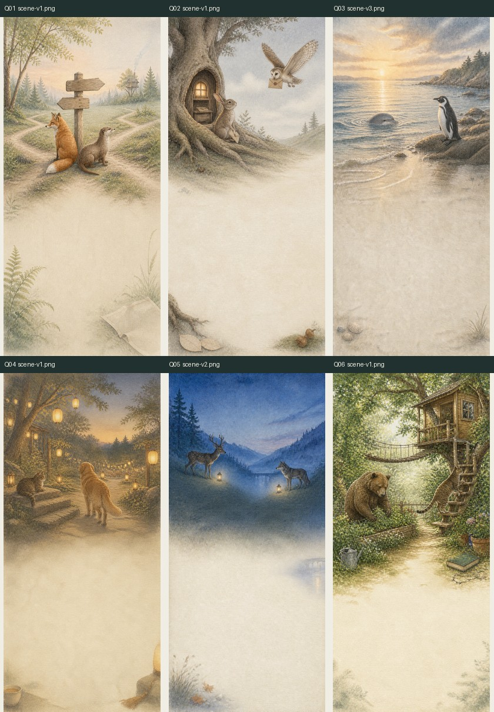
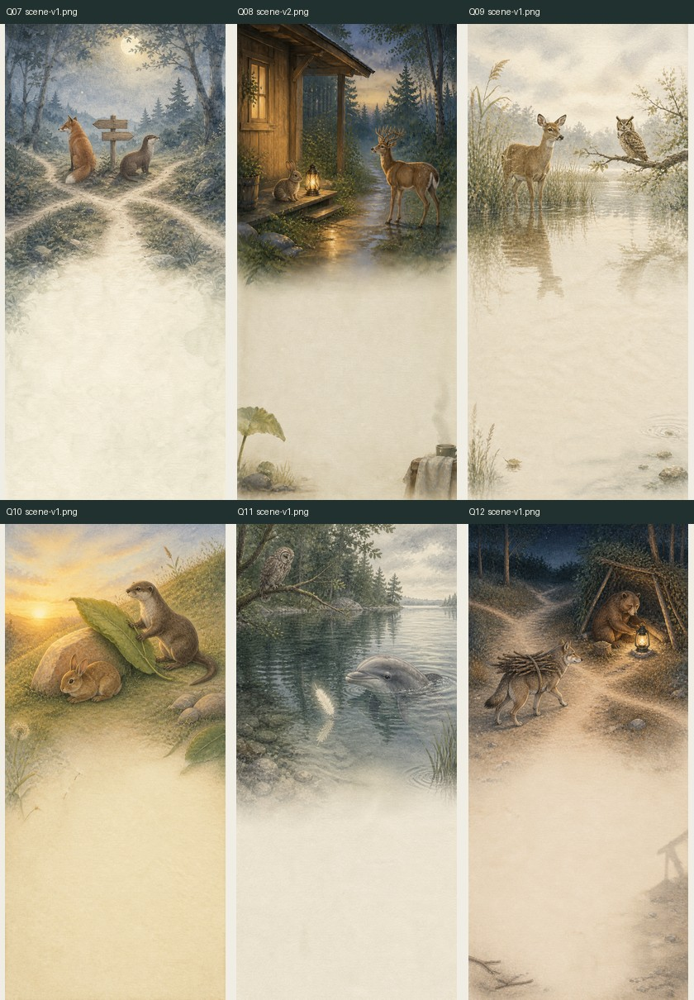
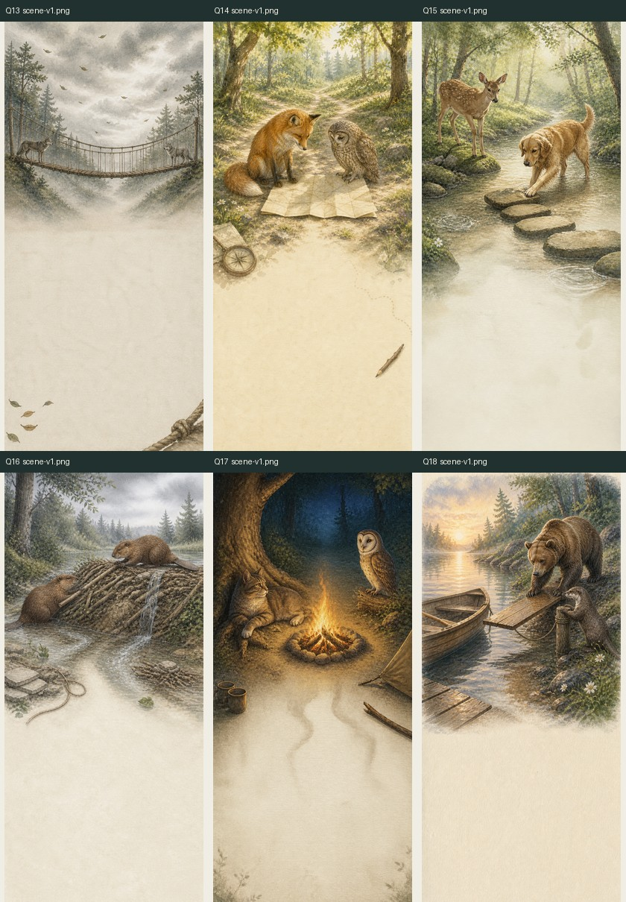
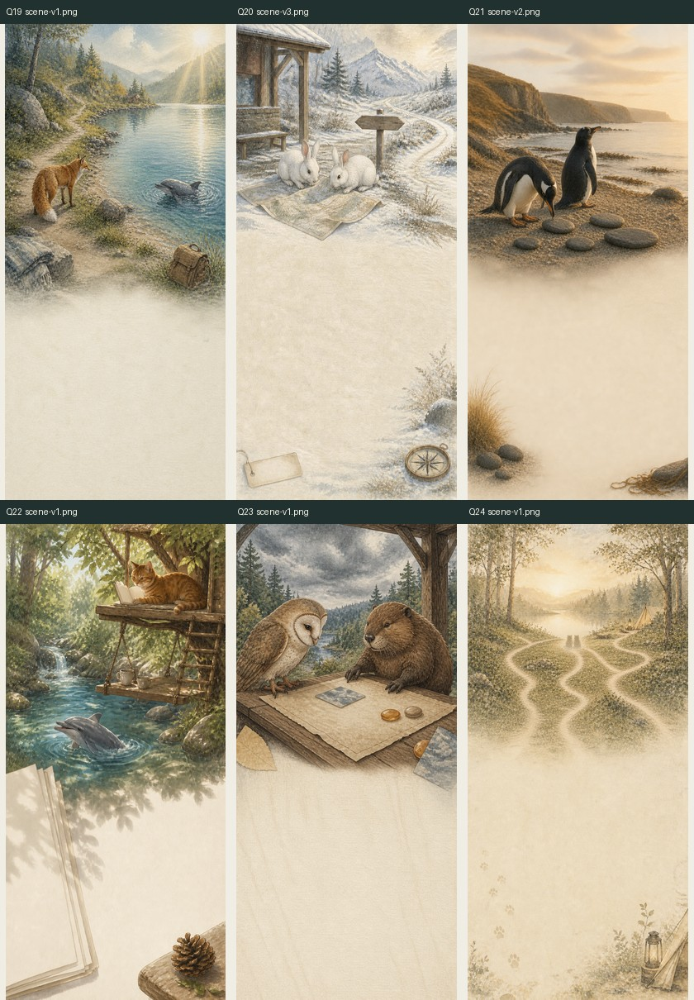

# 24 题场景图验收报告

验收日期：2026-08-29  
验收对象：`miniapp/assets/questions/q01` 至 `q24`  
对照规范：`docs/QUESTION_SCENE_ART_DIRECTION.md`

## 总结

- 文件完整度：**24/24，完整**。
- 画风统一度：**通过**。水彩/彩铅纹理、暖象牙白留白、低饱和森林色与成人治愈感基本统一。
- 场景差异度：**基本通过**。Q01 与 Q07 的“狐狸＋水獭＋路牌岔路”过于接近，建议重做 Q01。
- 内容符合度：**条件通过**。Q03、Q08、Q20 的动物角色与场景规范不一致。
- UI 安全区：**母图层面通过**。大部分图片上半部承担场景，下半部保留低纹理文字区域。
- 工程可用度：**未通过**。PNG 总体积约 58MB，且答题页代码尚未引用场景图。

2026-08-31 工程更新：Q01、Q03、Q08、Q20 已按下方问题清单修正；24 张母图已建立
显式 manifest，并生成统一 `600 × 1297` WebP 发布版，总计约 1.55 MiB。答题页已完成
首轮工程接入，仍需开发者工具视觉样板和真机逐题验收。因此当前状态应定义为：
**24 张高清母图和发布资源已齐，代码已接入，最终真机视觉验收待用户确认。**

## 视觉证据

### 第一章 Q01–Q06

### 第二章 Q07–Q12

### 第三章 Q13–Q18

### 第四章 Q19–Q24

## 文件与性能检查

- 每题目录均包含且仅包含 1 张当前场景图。
- 大多数图片为 `853 × 1844`；Q05、Q08、Q12、Q22 为 `852 × 1846`。
- 全部为 RGB PNG，无透明通道。
- 单张约 2.2–2.8MB，总计约 58MB。
- 临时验证：统一缩放到 `750 × 1624` 并以 WebP quality 82 输出后，24 张合计约 3.42MB，平均约 146KB/张。该结果仅用于容量评估，未覆盖原图。
- 当前答题页 `pages/test-run` 未检索到 `assets/questions`、`sceneAsset` 或 `scene-v*` 引用，说明图片尚未进入运行时 UI。

## 逐题验收

| 题号 | 场景健康度 | 结论 |
|---|---|---|
| Q01 | 需调整 | 构图和画风合格，但与 Q07 同为狐狸、水獭、木路牌与岔路，远看接近同一题的昼夜版本。建议保留 Q07，重做 Q01。 |
| Q02 | 健康 | 兔子、猫头鹰、树洞邮局清楚，等待感温和，下半部安全区充足。 |
| Q03 | 条件通过 | 海湾分享场景成立，但画面是海豚＋企鹅，规范为海豚＋水獭。需确认是更新规范还是换图。 |
| Q04 | 健康 | 猫与金毛处于灯会边缘，社交距离表达清晰，暖光克制。 |
| Q05 | 健康 | 鹿与狼隔谷相望，距离与连接同时存在，色彩差异也能丰富整组画面。 |
| Q06 | 健康 | 猫、棕熊、树屋和花园关系明确，独处不被画成疏远。 |
| Q07 | 健康/基准 | 与已确认方向最接近，月森、路牌、狐狸和水獭构成清晰，可作为统一基准。 |
| Q08 | 条件通过 | 疲惫回家与暖灯场景成立，但画面是兔子＋鹿，规范为棕熊＋鹿。 |
| Q09 | 健康 | 鹿、猫头鹰、薄雾湖岸表达观察和等待，画面没有强行制造悲伤。 |
| Q10 | 健康 | 兔子、水獭与叶片遮护形成温和照顾感，留白清楚。 |
| Q11 | 健康 | 猫头鹰、海豚和水面羽毛形成不同视角，场景在24张中辨识度较高。 |
| Q12 | 健康 | 狼、棕熊、营灯和夜路符合“不同形式的安慰”，暖光集中。 |
| Q13 | 健康 | 吊桥和两端动物形成张力，但没有断桥或攻击性，符合禁忌要求。 |
| Q14 | 健康 | 狐狸、猫头鹰与地图能直接表达“重新理解”，道具使用克制。 |
| Q15 | 健康 | 鹿、金毛和踏脚石表达修复行动，水面给 UI 留出空间。 |
| Q16 | 健康 | 两只河狸修补木坝，重复问题与共同处理的关系明确。 |
| Q17 | 健康 | 猫、猫头鹰和未熄篝火表达冷静距离，夜色与前后题形成变化。 |
| Q18 | 健康 | 棕熊、水獭、船与上岸木板表现重新连接，叙事动作可读。 |
| Q19 | 健康 | 狐狸、海豚、湖谷和背包表达周末节奏，场景明亮但仍属统一画风。 |
| Q20 | 需确认 | 旅行构图成立，但画面使用两只兔子；规范要求企鹅＋河狸，且 Q02 已使用兔子，角色区分度下降。 |
| Q21 | 健康 | 两只企鹅与月光石满足纪念日主题，没有落入戒指或昂贵礼物俗套。 |
| Q22 | 健康 | 猫在树屋、海豚在水面，共同平台与不同兴趣同时可见。 |
| Q23 | 健康 | 猫头鹰、河狸与地图桌面表达共同决策，下半部安全区充分。 |
| Q24 | 健康 | 动物剪影、不同道路与远处营地适合作为结尾，不提前泄露结果动物。 |

## 原必须修正项的处理状态

1. **Q01 与 Q07**：已处理。Q01 使用 `scene-v2.png`，Q07 保留基准 `scene-v1.png`。
2. **Q03/Q08/Q20 角色偏差**：已处理，分别使用 `scene-v4.png`、`scene-v3.png`、`scene-v4.png`。
3. **发布版素材**：已处理。母图保留，另生成每题 `scene.webp`。
4. **稳定映射**：已处理。见 `miniapp/assets/questions/manifest.json`。
5. **答题页接入**：代码首轮已处理。最终视觉、裁切和交互仍需开发者工具及真机验收。

## 建议修正

- 把 Q05、Q08、Q12、Q22 的尺寸统一到最终发布规格，避免 `cover` 裁切出现细微不一致。
- 在真机上叠加实际题目与四个选项后，复查文字对比度、动物遮挡和底部安全区。
- 当前图像只能证明静态视觉；快速答题、预加载失败、弱网占位、动效节奏和无障碍仍需在接入后测试。

## 验收边界

本次检查基于24张源图和当前答题页代码。未在真机中逐题叠加文字，因此不能据此声明最终页面的可读性、交互与无障碍已经通过。
